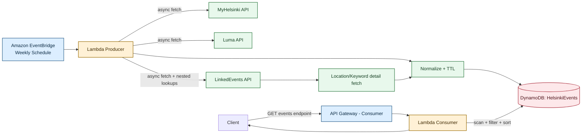
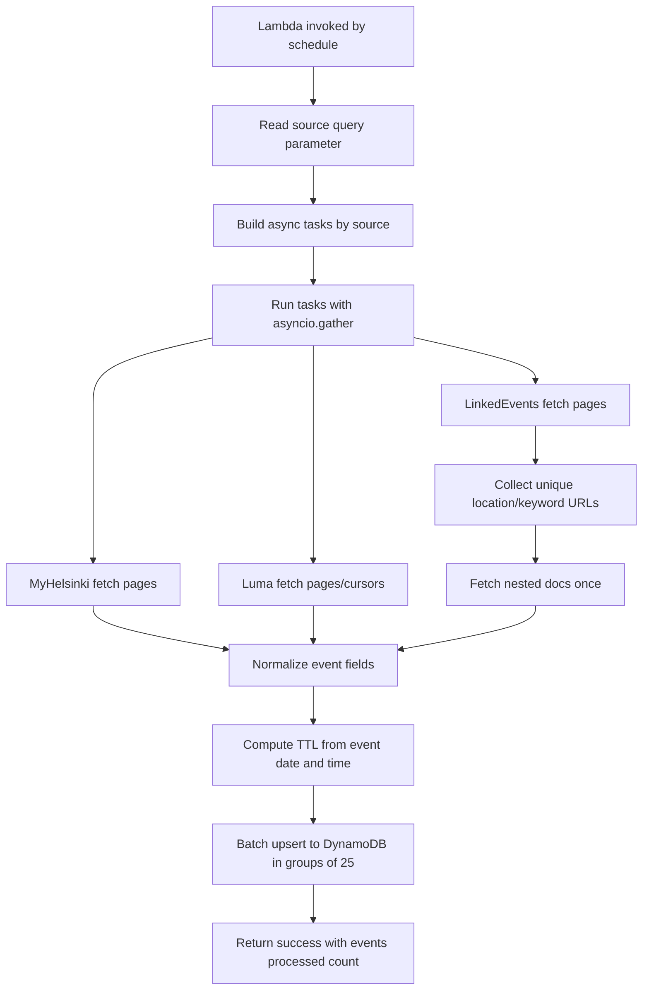
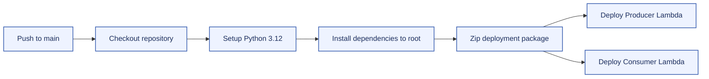

# Helsinki Events Lambda Package

This folder contains two AWS Lambda functions that work together:

1. **Producer** (`lambda_function.py`) fetches events from public Helsinki sources and writes them into DynamoDB.
2. **Consumer** (`consumer_lambda.py`) reads upcoming events from DynamoDB and returns them as API JSON.

The current implementation is **async-first** (not thread-pool based) and uses `aiohttp` + `asyncio` for concurrent API calls.

---

## What This Package Does

### Producer Lambda (`lambda_function.py`)

- Triggered automatically by an EventBridge schedule (weekly).
- Reads `source` from `queryStringParameters`.
- Supports these source values: `myhelsinki`, `luma`, `linked_events`, `all`.
- Fetches source APIs concurrently with `asyncio.gather`.
- Uses one shared semaphore (`MAX_CONCURRENCY = 10`) to limit outbound request pressure.
- Normalizes event fields into one common schema.
- Adds a `ttl` field: event date/time + 24 hours.
- Writes events to DynamoDB table `HelsinkiEvents` in batches of 25.
- Returns count of processed records.

### Consumer Lambda (`consumer_lambda.py`)

- Scans table `HelsinkiEvents`.
- Filters records where `date >= today`.
- Sorts by `date`, then `time`.
- Converts `Decimal` values into JSON-safe numbers.
- Returns `{ "events": [...] }` with CORS headers.

---

## Architecture (Current)



---

## Producer Flow (Detailed)



---

## Event Shape in DynamoDB

All providers are mapped into a common structure (some fields can be `null`):

```json
{
  "id": "linked-123 | myhel-123 | luma-123",
  "start_time": "2026-04-18T18:00:00",
  "title": "Event title",
  "description": "Event description",
  "location": [60.17, 24.94],
  "venue": "Venue name",
  "date": "2026-04-18",
  "time": "18:00:00",
  "price": 0,
  "img_url": "... or [ ... ]",
  "tags": ["music", "family"],
  "signup_link": "https://...",
  "created_by": "LinkedEvents | MyHelsinki | Luma",
  "created_at": "2026-04-18",
  "ttl": 1776544800
}
```

Notes:

- `ttl` is a Unix timestamp used by DynamoDB TTL cleanup.
- `img_url` type depends on source data and may be string or list.

---

## API Contract (Current Behavior)

### 1) Producer endpoint

Example request:

```http
GET /?source=all
```

Accepted `source` values:

- `myhelsinki`
- `luma`
- `linked_events`
- `all` (default)
- comma-separated values like `myhelsinki,luma`

Example response:

```json
{
  "status": "success",
  "events_processed": 342
}
```

### 2) Consumer endpoint

Example request:

```http
GET /
```

Example response:

```json
{
  "events": [
    {
      "id": "linked-123",
      "date": "2026-04-18",
      "time": "18:00:00"
    }
  ]
}
```

Both handlers return CORS headers for browser clients.

---

## Local Setup

```bash
python -m venv venv
venv\Scripts\activate
pip install -r requirements.txt
```

`requirements.txt` currently contains only:

- `aiohttp==3.10.11`

`boto3` is available in AWS Lambda runtime by default.

---

## Local Test Examples

### Producer local invoke

```python
from lambda_function import lambda_handler

event = {
    "queryStringParameters": {
        "source": "all"
    }
}

print(lambda_handler(event, None))
```

### Consumer local invoke

```python
from consumer_lambda import lambda_handler

print(lambda_handler({}, None))
```

If running locally, ensure your AWS credentials and DynamoDB access are configured.

---

## CI/CD (GitHub Actions)

Deployment workflow: `.github/workflows/deploy.yml`

Current pipeline:

1. Trigger on push to `main`.
2. Set up Python 3.12.
3. Install dependencies into project root.
4. Create `deployment_package.zip` (excluding `venv`, `.git`, `.github`, and the zip itself).
5. Deploy **Producer** Lambda: `helsinki-event-aggregator`.
6. Deploy **Consumer** Lambda: `HelsinkiEventsConsumer`.



Required GitHub secrets:

- `AWS_ACCESS_KEY_ID`
- `AWS_SECRET_ACCESS_KEY`

Region is currently set directly in workflow as `eu-north-1`.
